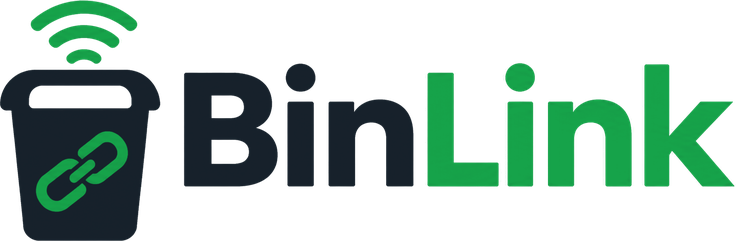
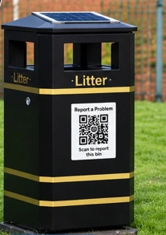
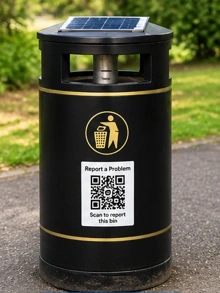
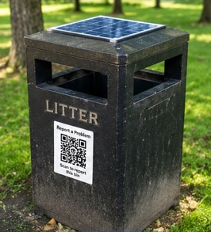

<div align="center">



# BinLink — Smart Waste Management

**Smarter bins. Cleaner streets.**

[🌐 Open BinLink](https://binlink.pages.dev) · [Report an issue](https://binlink.pages.dev/#report) · [Council portal](https://binlink.pages.dev/#dashboard)

  

</div>

---

BinLink is an interactive, mobile-friendly prototype connecting public litter bins, residents and council waste management teams. It combines QR-code reporting with a proposed retrofit solar-powered sensor system and a council management dashboard.

## Product overview

| BinLink Report | BinLink Sensor | BinLink Dashboard |
| :--- | :--- | :--- |
| Report overflowing, damaged or problematic bins using a QR code or the website. | Concept for solar-powered monitoring of existing public bins. | Review reported issues, monitor fill levels, and manage collections. |

## Device concepts

<table>
<tr><th>Square street bin</th><th>Cylindrical park bin</th><th>Existing litter bin retrofit</th></tr>
<tr><td></td><td></td><td></td></tr>
</table>

The artwork illustrates proposed installations, not manufactured products. QR codes in the concept images are illustrative.

## Website and council portal

| Public website | Council management |
| --- | --- |
| Responsive homepage and product information | Interactive OpenStreetMap street map with fictional bin markers |
| Two-step QR-first reporting, camera and photo scanning | Searchable bin inventory and individual bin details |
| Bin-specific QR codes and direct reporting links | Report status management and collection actions |
| Mobile-friendly navigation | Analytics, CSV exports and simulated sensor updates |

[Explore the interactive website →](https://binlink.pages.dev)

## QR reporting

Open the council portal, select a bin on the map and choose **View QR code**. Scan that code with a phone camera or use the website scanner. Each code opens the correct bin automatically; choose an issue and submit. Use a saved QR photo or select an example bin if a camera is unavailable.

## Run locally

No Node.js installation, API keys or build process are needed. Internet access is used for the map and QR libraries. Clone the repository and serve its root directory:

```bash
git clone https://github.com/JNathan34/BinLink.git
cd BinLink
python -m http.server 8000
```

Open [http://localhost:8000](http://localhost:8000). Submit a fictional report, then open the council portal to review and resolve it.

## Deploy on Cloudflare Pages

This is a static HTML, CSS and JavaScript project.

1. In Cloudflare, open **Workers & Pages** and create a Pages project connected to GitHub.
2. Select `JNathan34/BinLink` and the production branch `main`.
3. Use these build settings:

| Setting | Value |
| --- | --- |
| Framework preset | None |
| Build command | Leave empty |
| Build output directory | `.` |
| Root directory | Leave empty |
| Production branch | `main` |
| Environment variables | None required |

4. Save and deploy. The intended public URL is [binlink.pages.dev](https://binlink.pages.dev).

## Project structure

```text
BinLink/
├── index.html          # Website entry point
├── style.css           # Responsive design system
├── app.js              # Navigation, reporting and portal logic
├── assets/
│   ├── logo.png         # BinLink wordmark
│   ├── symbol.png       # BinLink icon
│   ├── bin-1.webp       # Square bin concept
│   ├── bin-2.webp       # Round bin concept
│   └── bin-3.webp       # Retrofit bin concept
└── README.md
```

## Prototype limitations

All operational data is fictional. Reports and changes are stored locally in the browser where supported. There is no backend, real authentication, live sensor connection, verified real-world bin locations or council integration. Do not submit real personal information. The removed top demonstration banner remains removed. Map tiles are provided by OpenStreetMap, with attribution; example marker locations are fictional. Camera scanning requires HTTPS (or localhost), permission and browser support. Standard phone-camera QR links and example-bin selection remain available. Images scanned in the browser are not uploaded.

## Brand

**Primary green** `#16A34A` · **Dark green** `#166534` · **Charcoal** `#17212B` · **White** `#FFFFFF`

<div align="center">

**BinLink** · Smarter bins. Cleaner streets.

[Visit website](https://binlink.pages.dev)

</div>
